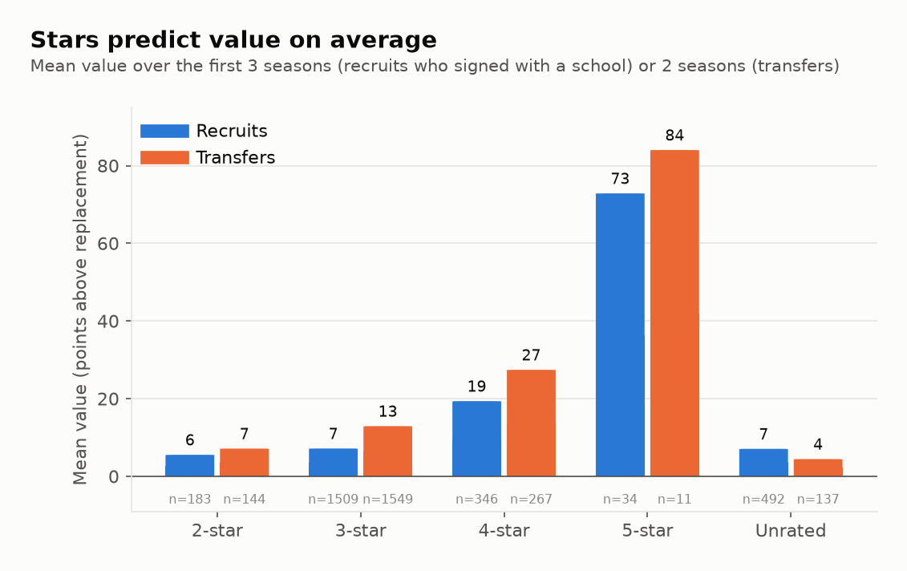
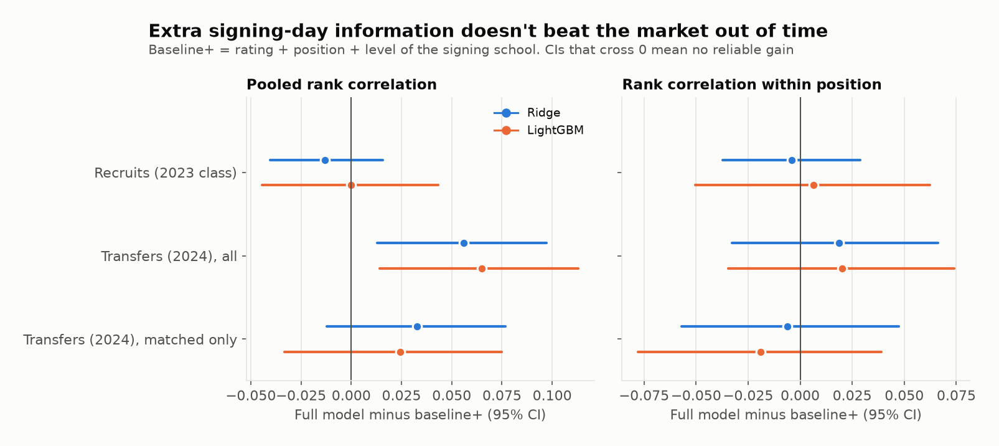
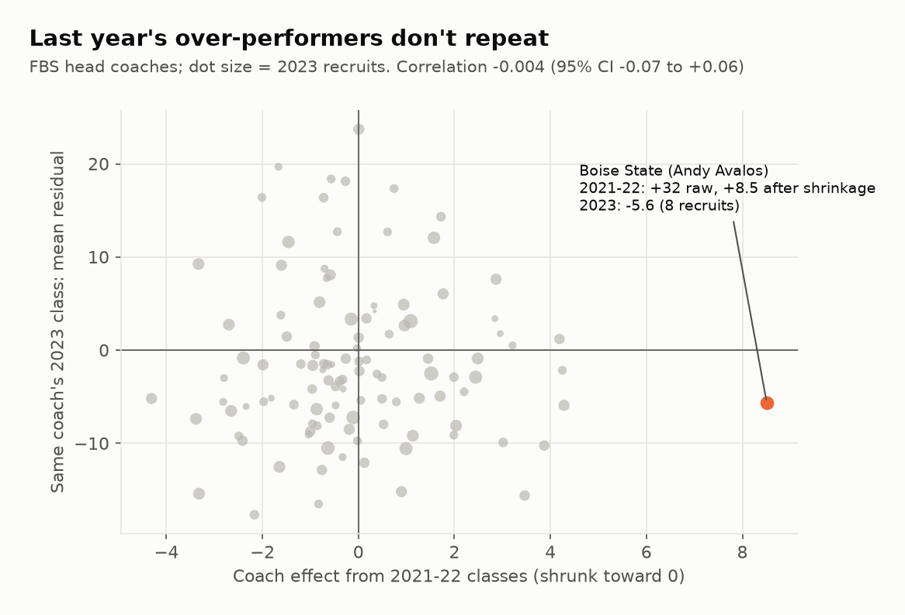

# CFB Moneyball: is college football talent mispriced?

*Python · pandas · scikit-learn · LightGBM · matplotlib · pytest · CollegeFootballData API*

Every year, college programs spend scholarships on high-school recruits and transfer-portal
players, and the "price" of a player is his star rating. This project asks a Moneyball
question: **using only what is known on signing day, can you find players the market
undervalues?** I linked five years of recruiting and portal data to on-field production
(2021-2025, ~8,500 QB/RB/WR acquisitions), defined value as production above a replacement
player, and tested every idea out of time: train on earlier classes, score once on a
later one.

**Short answer: the market is close to efficient.** Ratings are noisy, but the extra
signing-day information I could get didn't beat them out of time. One signal is worth
following up: QB transfers' prior playing time.



## Key findings

1. **Ratings are right on average but noisy for individuals.** Across all players, 5-stars
   average about 12x the value of 3-stars for recruits (73 vs 6.2) and about 6.5x for
   transfers (84 vs 13); the chart shows recruits who signed with a school, where 3-stars
   average 7. But the rank correlation between rating and value is only about 0.2.
2. **Signing-day features don't beat the market.** A full model (size, home region,
   high-school rating, prior production, ...) does no better than
   *rating + position + level of the signing school* for recruits (difference -0.013,
   95% CI -0.040 to +0.016). For transfers it looks better on a pooled ranking, but the
   gain disappears within position and on cleanly matched players.
3. **Suggestive: prior playing time for QB transfers.** Adding prior plays improved the
   ranking of QB transfers in both test years (+0.08 in 2024, +0.12 in 2025), but each
   confidence interval just touches zero. Worth confirming, not yet a finding.
4. **No school, coach, or region consistently beats its ratings.** Group effects measured
   on the 2021-22 classes didn't predict the 2023 class (all correlations within ±0.02,
   CIs spanning 0). A power simulation shows effects of about 5 points or more would have
   shown up, so those are ruled out. Smaller ones can't be.



### Example: Boise State, the over-performer that didn't repeat
Out of 229 schools, one passed a false-discovery correction: Boise State's 12 recruits from
the 2021-22 classes (under coach Andy Avalos) beat their rating-based prediction by an
average of +32 points per recruit. Its 2023 class averaged -5.6 per recruit (8 recruits). A good story from one sample that disappears in the next is exactly what
shrinkage and out-of-time testing are for.



All six charts and the numbers behind them: [results/summary.md](results/summary.md).

## Pitfalls caught along the way
- **A fake market blind spot.** Unrated recruits seemed to beat 3-stars. It was selection:
  unrated records only exist for players who signed somewhere, while 13.5% of 3-stars never
  signed with a covered school and score 0. On equal terms the gap disappears.
- **Two leaks in the transfer model.** A "seasons of prior data" feature was really the
  season in disguise, and a "missing history" flag mostly marked players I had failed to
  match (whose value is 0 by construction). Both were removed before the final results.
- **Mislabeled positions.** Some QBs are listed as WRs in other seasons (one produced an
  impossible -269 season), so each season's position now comes from what the player did.
- **Unfair baselines.** A rating-only baseline loses to any model that knows position,
  because QBs produce far more value. That would look like an inefficiency when it's just
  scale. Baselines include position, and results are reported within position.
- **Joins that guess.** A rule meant to merge players split across two IDs also merged two
  different Daniel Jacksons (a WR and a kicker), so merges now require compatible positions.
  A 100-player hand check estimated the remaining match error (labels were AI-assisted,
  with ambiguous cases verified by web search).

## Data and method
- **Data:** [CollegeFootballData.com](https://collegefootballdata.com) API (free tier, ~50
  calls): recruiting rankings 2017-2025, transfer portal, player PPA, usage and box scores
  2021-2025, the NFL draft 2021-2026, FBS head coaches, and team locations.
- **Linking:** recruits, portal entries and draft picks are joined to stat lines by ID where
  possible, then by name + team + season. Ambiguous matches stay unmatched rather than
  guessed.
- **Value:** PPA (expected points added per play) above a replacement-level player at the
  same position, season and level, summed over 3 seasons for recruits and 2 for transfers.
  FCS seasons are converted to FBS-equivalent (0.48) using players who moved between levels.
- **Models:** ridge regression and LightGBM, each compared with the same learner on the
  baseline feature sets. Tuning uses cross-validation grouped by player, inside the
  training years only.
- **Tests:** rank correlation (pooled and within position) and within-tier lift, with
  paired bootstrap CIs. Group effects use empirical Bayes shrinkage, permutation p-values,
  and a Benjamini-Hochberg false-discovery correction.

## Limitations
- **Public stats can't measure blocking,** so offensive and defensive linemen are out of
  scope and tight ends are undervalued (they appear only in the group analysis).
- **PPA depends on team context.** Scheme and supporting cast shape a player's production,
  so value partly reflects where he played, not only how good he is.
- **Coaches data covers FBS only,** so the coach analysis skips FCS signees.
- **Single test years.** Recruits are tested on the 2023 class and transfers on 2024, with
  2025 only as a one-season check. More seasons are needed before any signal is trusted.
- **Matching isn't perfect.** About 30% of transfers I couldn't match probably did play;
  results are shown with and without them.

## Reproduce
```bash
pip install -r requirements.txt            # Python 3.11+
# Copy .env.example to .env and add your key (free from collegefootballdata.com)
python -m cfb.fetch --run                  # ~50 API calls, cached in data/raw/
python -m cfb.crosswalk                    # link recruits / portal / draft to players
python -m cfb.master                       # one row per acquisition, with outcomes
python -m cfb.modeling.run                 # baselines, ridge, LightGBM, SHAP (~10 min)
python -m cfb.modeling.prior_plays         # QB prior-plays test
python -m cfb.modeling.group_analysis      # school / coach / in-state persistence
python results/make_charts.py              # the charts in results/
pytest                                     # 139 tests
```

## Future work
- **Confirm the QB signal with 2026 data:** a third test year, and a full two-season window
  for 2025 transfers.
- **Offensive and defensive linemen,** if better data (snap counts, grades) becomes
  available.
- **Verified athleticism:** test whether measured speed (e.g. high-school 100m times)
  predicts value beyond rating.
- **A live portal board:** rank incoming transfers by the model's value estimate against
  their rating, and track how the picks turn out.

---
Brayden Whitfield · bwhitfield817@gmail.com
