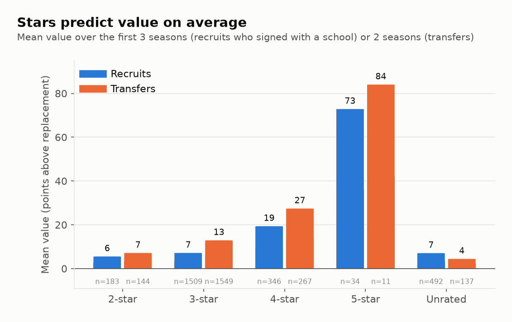
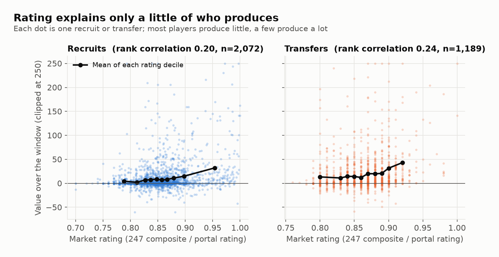
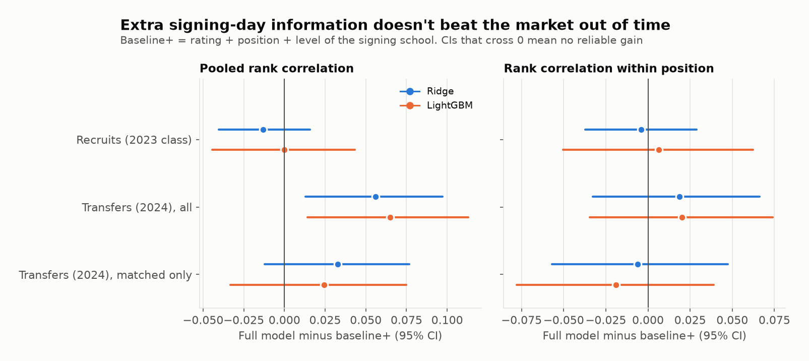
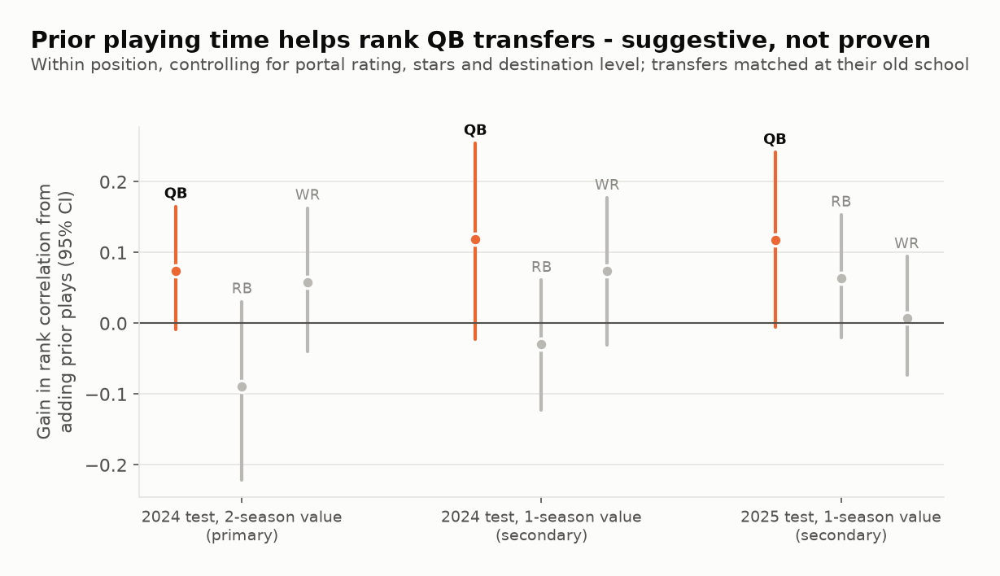
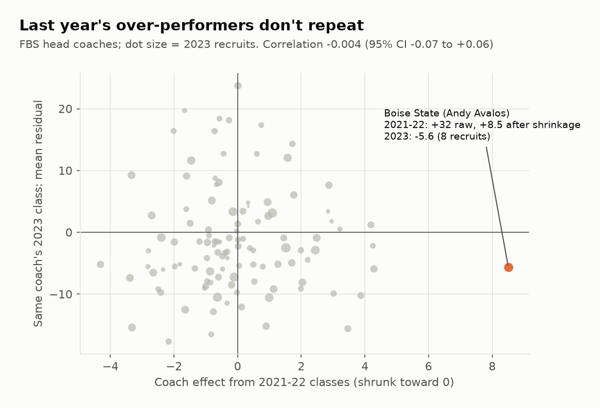
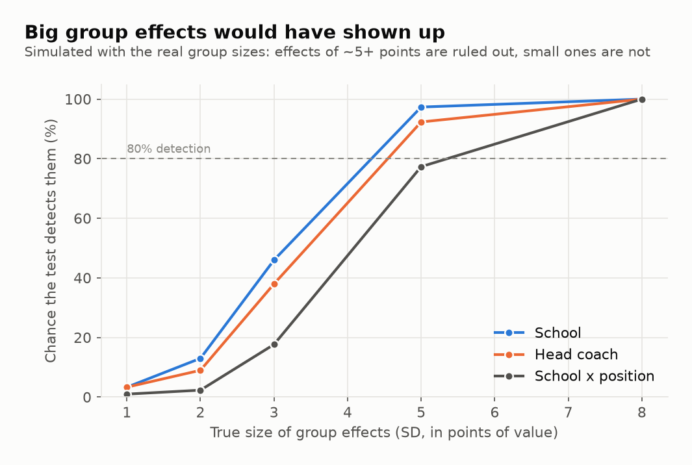

# Results summary

All numbers are out of time: models are trained on earlier years and scored once on a
later one. CIs are 95% bootstrap intervals. Value = PPA above replacement (FBS-equivalent),
summed over a player's first 3 seasons (recruits) or 2 seasons (transfers).

## 1. Stars predict value on average, but weakly

- Across all players, a 5-star averages about 12x the value of a 3-star for recruits
  (73 vs 6.2) and about 6.5x for transfers (84 vs 13). The chart shows recruits who
  signed with a school, where 3-stars average 7.
- But rating ranks individual players poorly: rank correlation 0.20 for recruits who signed
  with a school (0.23 including those who didn't), 0.24 for transfers.

## 2. Extra signing-day information doesn't beat the market

Baseline+ = rating + position + level of the signing school. The full model adds every
other signing-time feature (size, home region, high-school rating, prior production, ...).

| Test | Full minus baseline+ (rank correlation) |
|---|---|
| Recruits, 2023 class (ridge) | -0.013 [-0.040, +0.016] |
| Recruits, 2023 class (LightGBM) | -0.000 [-0.044, +0.043] |
| Transfers, 2024, all (LightGBM) | +0.065 [+0.014, +0.113] |
| Transfers, 2024, within position (LightGBM) | +0.020 [-0.034, +0.074] |
| Transfers, 2024, matched only (LightGBM) | +0.024 [-0.033, +0.075] |

The transfer gain appears only in the pooled ranking. It disappears within position and
when unmatched transfers are dropped, so it is not evidence of underpriced players.

## 3. One suggestive signal: QB transfers' prior playing time

Within position, controlling for portal rating, stars and destination level:

| Test | QB | RB | WR |
|---|---|---|---|
| 2024, 2-season value (primary) | +0.075 [-0.008, +0.165] | -0.090 | +0.058 |
| 2024, 1-season value | +0.119 [-0.023, +0.254] | -0.029 | +0.074 |
| 2025, 1-season value | +0.117 [-0.005, +0.241] | +0.064 | +0.008 |

QBs are positive in both test years; each CI just touches 0, and several comparisons were
run. Suggestive, not established.

## 4. No school, coach, or region consistently beats its rating

Group effects estimated on the 2021-22 classes (empirical Bayes shrinkage), checked against
the 2023 class:

| Grouping | Correlation with 2023 residuals |
|---|---|
| School | +0.016 [-0.039, +0.072] |
| School x position | -0.007 [-0.083, +0.066] |
| Head coach | -0.004 [-0.072, +0.061] |
| In-state minus out-of-state (2023) | -0.45 points [-2.69, +1.74] |

The test would have caught group effects with an SD of 5 points 77-97% of the time, so
effects that large are ruled out; effects of 3 points or less could still exist.

One group survived the false-discovery correction (Benjamini-Hochberg, q < 0.10): Boise
State under Andy Avalos, +32 points per recruit in 2021-22 (12 recruits). Its 2023 class
came in at -5.6 (8 recruits).

## Where the numbers come from
`data/processed/models/report.txt`, `prior_plays_report.txt` and `groups_report.txt`
(regenerated by the commands in the README); `model_vs_baseline_plus.csv` holds the
chart 3 values. Charts: `python results/make_charts.py`.
